# Relatório de BUGS API

## BUG-01 - API não valida os campos da requisição 
**Execução de teste relacionado:** EV-API-04  
**Cenário de teste relacionado:** CT-API-04  
**Funcionalidade:** Cadastro de Funcionários   
**Severidade:** Alta  
**Prioridade:** Alta  
**Ambiente:** Google Chrome  

## 1. Pré-condições:
- API REST disponível e acessível
- Endpoint de consulta identificado
- Método POST/GET suportado
- Funcionários previamente cadastrados

## 2. Descrição:
A API permite o cadastro de funcionários com campos vazios e nulos, retornando uma resposta de sucesso e criando registros sem os dados necessários

## 3. Passos para reproduzir:
  
  1. Acessar a API usando Postman: "https://analista-teste.seatecnologia.com.br/employees"
  2. Selecionar o metodo POST
  3. Configurar Body: raw
  4. inserir o JSON:
  {
        "id": "",
        "state": {
            "employee": {
                "isActive": null,
                "name": "",
                "gender": "",
                "cpf": "",
                "birthDay": "",
                "rg": "",
                "role": "",
                "usesEpi": null ,
                "activity": "",
                "epi": "",
                "caNumber": ""
            }
        }
    }
  5. Enviar requisição

## 4. Resultado esperado:
A API deve impedir a ação da requisição, retornando o Status HTTP "400" Bad Request e a mesagem de erro

## 5. Resultado obtido
A API não valida os campos, assim criando o funcionário, exibindo a resposta "201 Created", retornando o JSON com os campos vazios e sendo apresentado na consulta

## 6. Evidências
**Evidência 22 — [Criando funcionário com campos ausentes]**

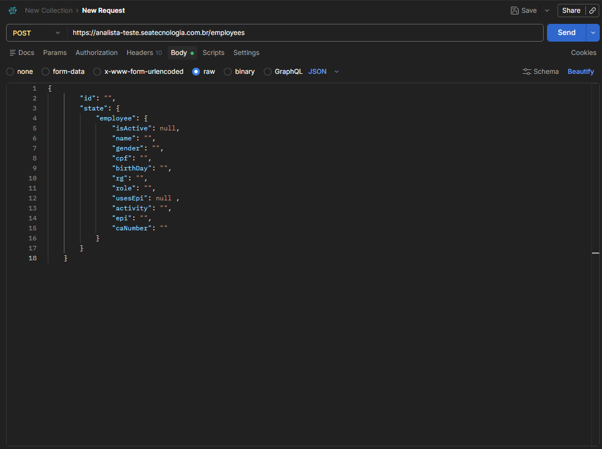

**Evidência 23 — [Funcionário cadastrado]**

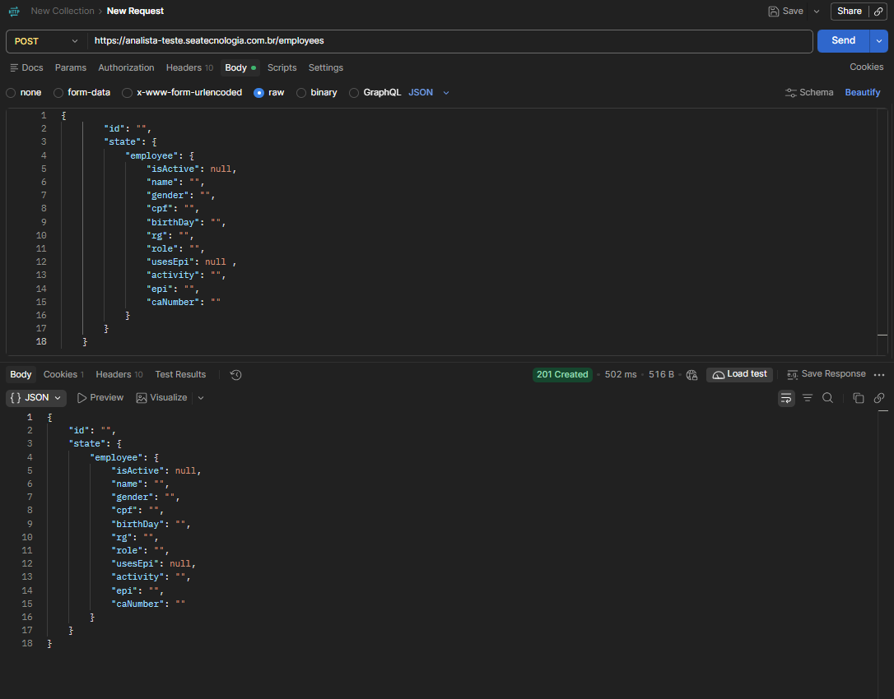

**Evidência 24 — [Consulta do funcionário cadastrado com campos vazios]**

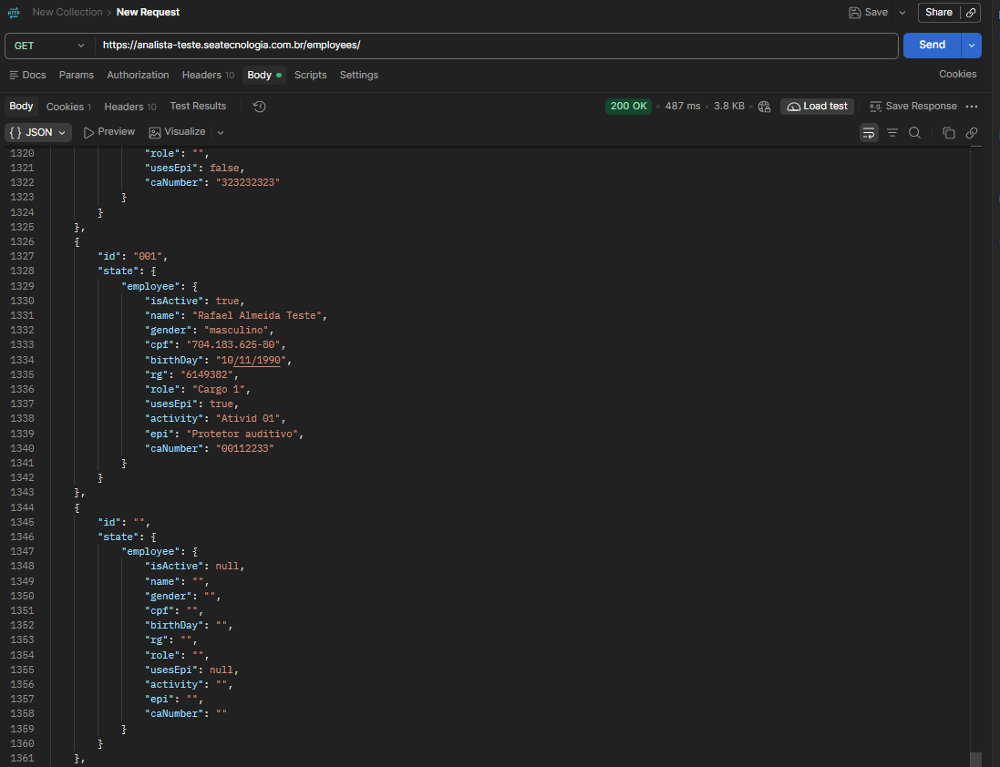

---

## BUG-02 - API não valida CPF já existente no sistema
**Execução de teste relacionado:** EV-API-05  
**Cenário de teste relacionado:** CT-API-05  
**Funcionalidade:** Cadastro de Funcionários   
**Severidade:** Alta  
**Prioridade:** Alta  
**Ambiente:** Google Chrome  

## 1. Pré-condições:
- API REST disponível e acessível
- Endpoint de consulta identificado
- Método POST/GET suportado
- Funcionário com CPF determinado cadastrado

## 2. Descrição:
A API permite nova requisição utilizando CPF já cadastrado no sistema, não retornando status e resposta esperados e não validando a regra de unicidade do CPF

## 3. Passos para reproduzir:
  
  1. Acessar a API usando Postman: "https://analista-teste.seatecnologia.com.br/employees"
  2. Selecionar o metodo POST
  3. Configurar Body: raw
  4. inserir o JSON:
  {
        "id": "002",
        "state": {
            "employee": {
                "isActive": false,
                "name": "Gojo satoru honrado",
                "gender": "masculino",
                "cpf": "704.183.625-80",
                "birthDay": "1999-12-04",
                "rg": "6293612",
                "role": "Cargo 4",
                "usesEpi" true ,
                "activity": "Ativid 04",
                "epi": "Protetor auditivo",
                "caNumber": "996283"
            }
        }
    }
  5. Enviar requisição

## 4. Resultado esperado:
A API deve negar a requisição retornando o status "409 Conflict" e a mensagem de erro esperada

## 5. Resultado obtido
A API aceitou a requisição não validando a unicidade de CPF, retornando o status "201 Created", o JSON com o CPF existente e exibiu o funcionário na consulta 

## 6. Evidências
**Evidência 25 — [Criando funcionário com cpf já existente]**

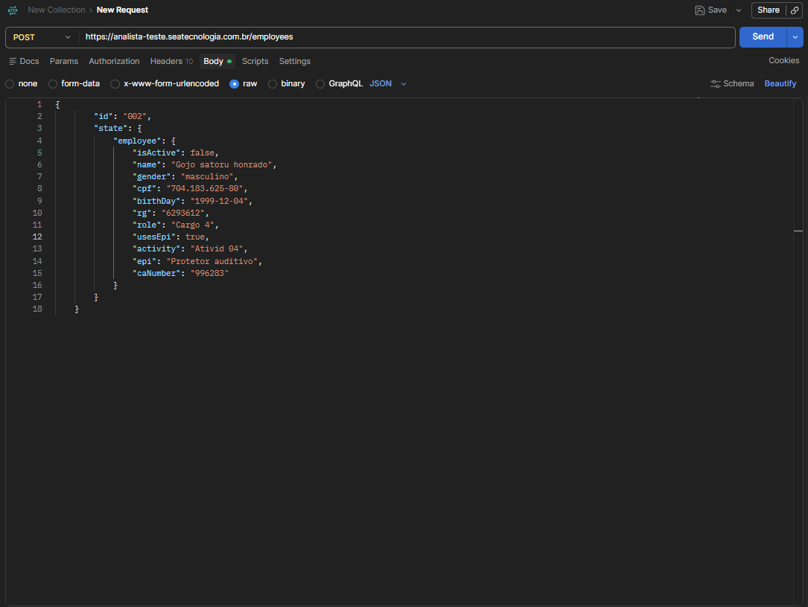

**Evidência 26 — [Retorno da resposta e cadastro do funcionário em JSON]**

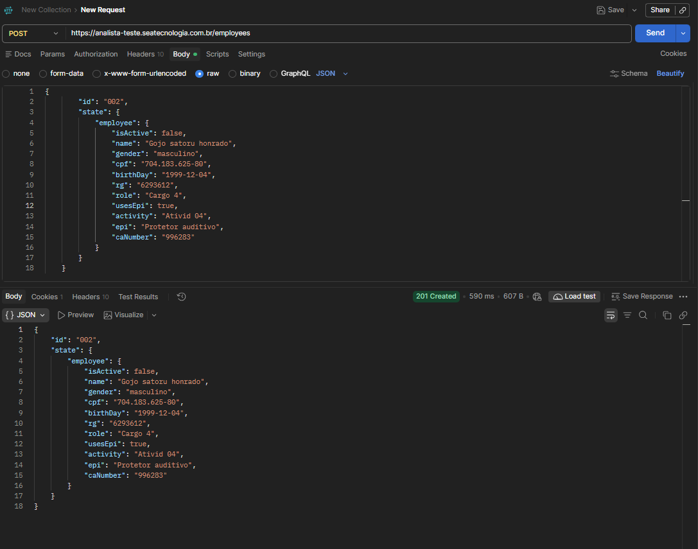

**Evidência 27 — [Consulta do funcionário cadastrado com cpf já existente]**

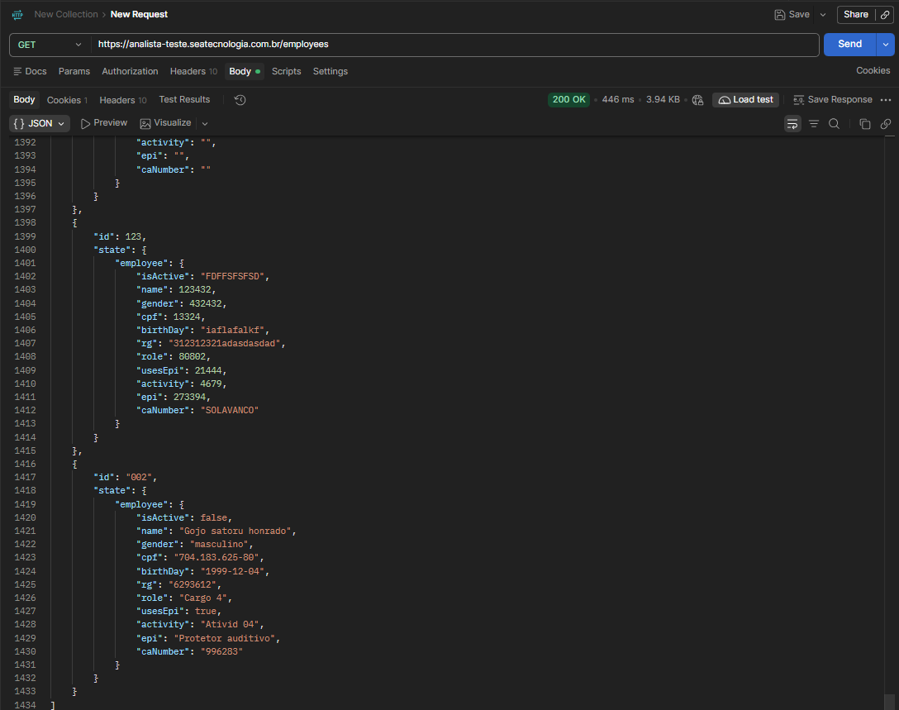

---

## BUG-03 - API não valida campos com dados inválidos
**Execução de teste relacionado:** EV-API-06  
**Cenário de teste relacionado:** CT-API-06  
**Funcionalidade:** Cadastro de Funcionários   
**Severidade:** Alta  
**Prioridade:** Alta  
**Ambiente:** Google Chrome  

## 1. Pré-condições:
- API REST disponível e acessível
- Endpoint de consulta identificado
- Método POST/GET suportado

## 2. Descrição:
A API permite requisição criando novo funcionário com dados inválidos, não retornando o status e resposta esperados e não validando regra de contrato da API sobre os campos

## 3. Passos para reproduzir:
  
  1. Acessar a API usando Postman: "https://analista-teste.seatecnologia.com.br/employees"
  2. Selecionar o metodo POST
  3. Configurar Body: raw
  4. inserir o JSON:
  {
        "id": "123",
        "state": {
            "employee": {
                "isActive": "FDFFSFSFSD",
                "name": 123432,
                "gender": 432432,
                "cpf": 13324,
                "birthDay": "iaflafalkf",
                "rg": "312312321adasdasdad",
                "role": 80802,
                "usesEpi": 21444,
                "activity": 4679,
                "epi": 273394,
                "caNumber": "SOLAVANCO"
            }
        }
    }
  5. Enviar requisição

## 4. Resultado esperado:
A API deve negar a requisição retornando o status "400 Bad Request" ou "422 Unprocessable Content" e a mensagem de erro

## 5. Resultado obtido
A API aceitou a requisição retornando o status "201 Created", o corpo da requisição JSON e foi exibido na listagem

## 6. Evidências
**Evidência 28 — [Criando funcionário utilizando dados inválidos]**

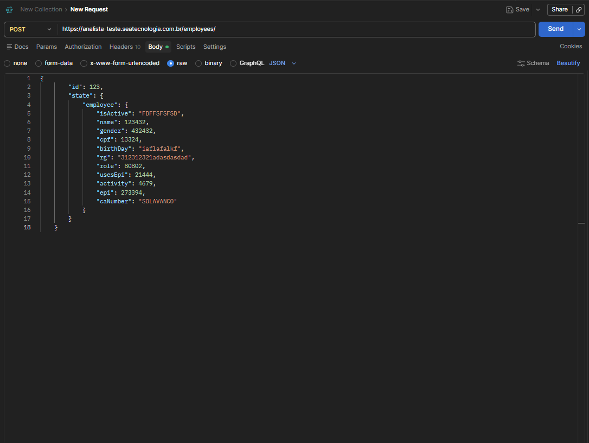

**Evidência 29 — [Funcionário criado com sucesso]**

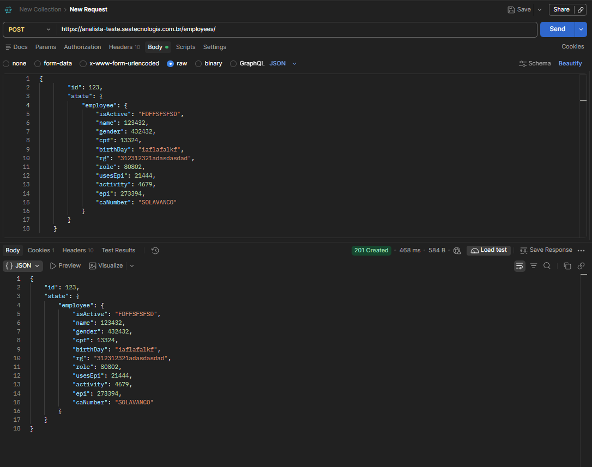

**Evidência 30 — [Consulta de funcionário exibindo dados inválidos]**

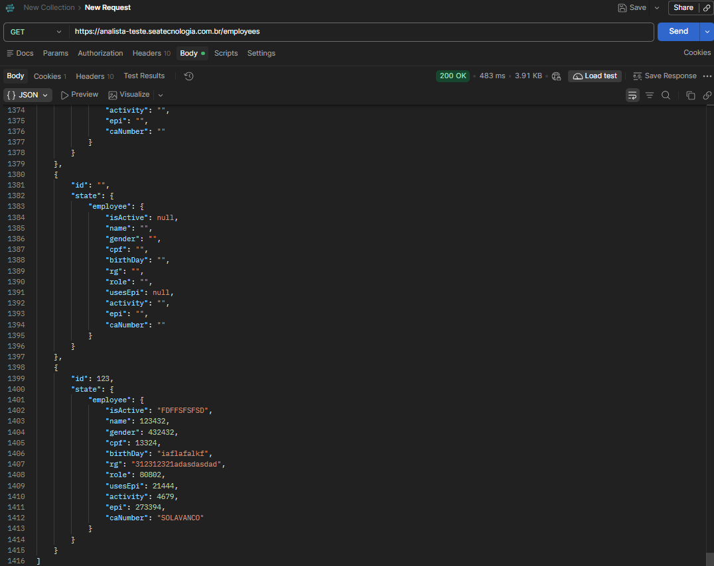

---

## BUG-04 - API não atende corretamento sobre a requisição para atualizar apenas 1 dado do funcionário
**Execução de teste relacionado:** EV-API-08  
**Cenário de teste relacionado:** CT-API-08  
**Funcionalidade:** Cadastro de Funcionários   
**Severidade:** Alta  
**Prioridade:** Alta  
**Ambiente:** Google Chrome  

## 1. Pré-condições:
- API REST disponível e acessível
- Endpoint de consulta identificado
- Método PATCH/GET suportado
- Funcionários previamente cadastrados

## 2. Descrição:
A API deveria atualizar somente 1 dado escolhido do funcionário, retornando o JSON com o dado desejado atualizado entretando a requisição utilizando o método PATCH substitui o cadastro do funcionário pelo JSON usado para realizar a atualização

## 3. Passos para reproduzir:
  
  1. Acessar a API usando Postman: "https://analista-teste.seatecnologia.com.br/employees"
  2. Selecionar o metodo PATCH
  3. Configurar Body: raw
  4. inserir o JSON:
  {
  "id": "002",  
  "state": {
    "employee": {
      "name": "Sea Teste Atualizado"
    }
  }
}
  5. Enviar requisição

## 4. Resultado esperado:
A API aceitar a requisição retornando o status "200 OK" e a resposta de sucesso retornando corpo JSON da Requisição

## 5. Resultado obtido
A API aceitou a requisição retornando status, resposta esperados e corpo JSON, no entanto entregou a ação referente ao status "201" Created, substituindo o cadastro do funcionário pelo JSON utilizado na requisição

## 6. Evidências
**Evidência 33 — [Criando funcionário utilizando dados inválidos]**

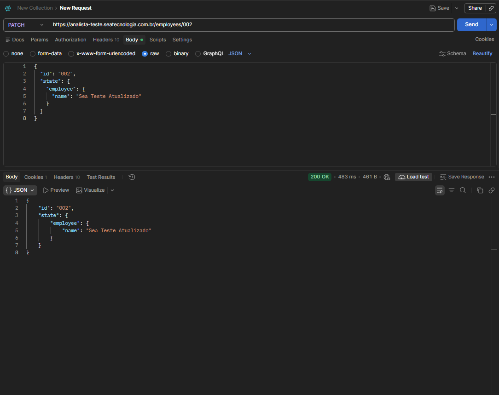

**Evidência 34 — [Funcionário criado com sucesso]**

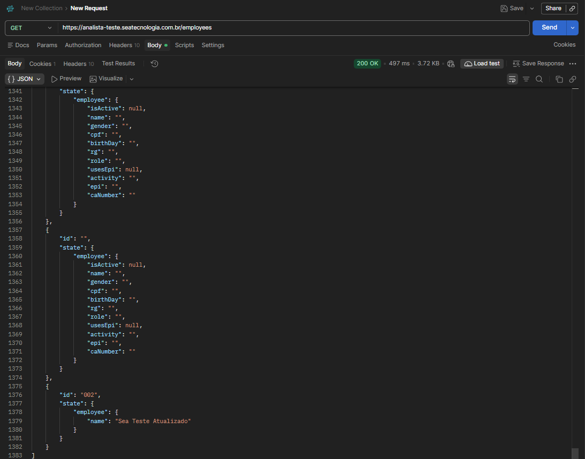
