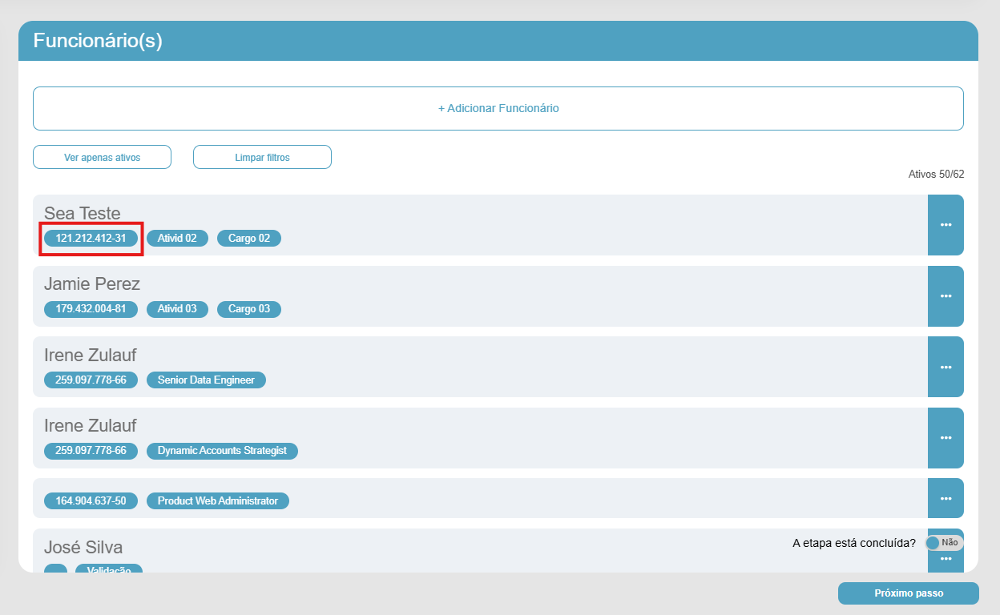
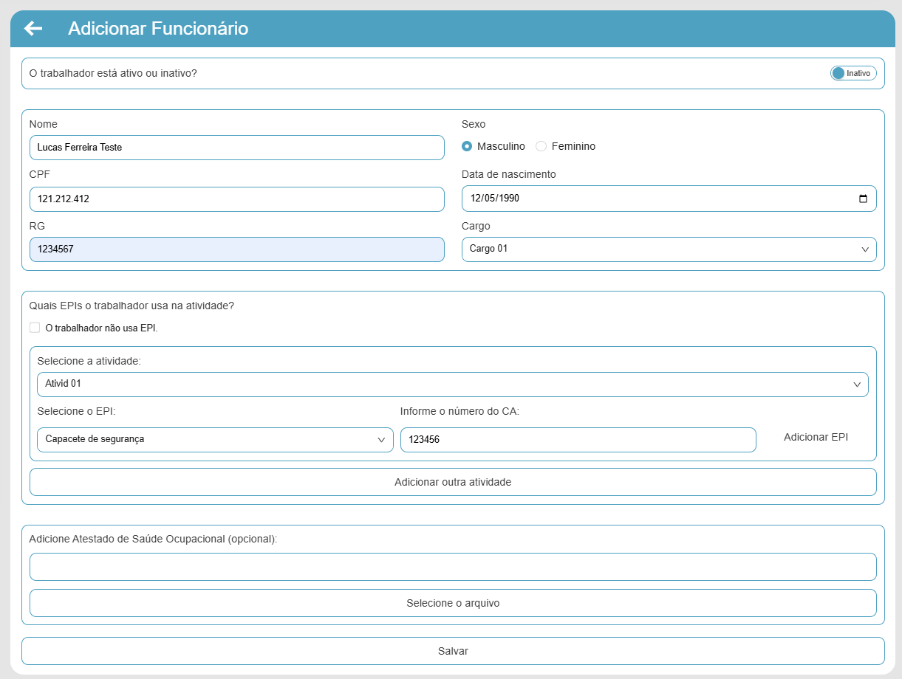
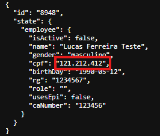

# Relatório de BUGS Interface

## BUG-IT-01 - Sistema não valida o campo CPF e permite cadastro com duplicidade  
**Execução de teste relacionado:** EV-03  
**Cenário de teste relacionado:** CT-03 
**Funcionalidade:** Cadastro de Funcionários  
**Severidade:** Alta  
**Prioridade:** Alta  
**Ambiente:** Google Chrome  

## 1. Pré-condições:
  - Aplicação disponível e Acessível 
  - Acessar o formulário de cadastro
  - Utilizar CPF de um funcionário cadastrado

## 2. Passos para reproduzir:
  
  1. Preencher o campo Nome com "Lucas Ferreira Teste"
  2. Preencher o campo CPF com "121.212.412-31"
  3. Preencher os demais campos com dados válidos
  4. Salvar o cadastro

## 3. Resultado esperado:

O sistema deve impedir o cadastro do funcionário e apresentar uma mensagem informando que o sistema já possui um funcionário com o CPF inserido cadastrado

## 4. Resultado obtido

O sistema não valida o campo CPF permitindo a realização do cadastro e não exibe nenhuma mensagem informativa

## 5. Evidências
**Evidência 01 — [CPF de funcionário cadastrado]**

**Evidência 02 — [Preenchimento do campo com cpf já cadastrado e dos demais campos obrigatórios]**

**Evidência 03 — [Cadastro realizado com duplicidade do CPF]**

---

## BUG-IT-02 - Botão para associar multiplas EPIs ao funcionário está inativo
**Execução de teste relacionado:** EV-04
**Cenário de teste relacionado:** CT-04  
**Funcionalidade:** Cadastro de Funcionários  
**Severidade:** Alta  
**Prioridade:** Alta   
**Ambiente:** Google Chrome  

## 1. Pré-condições:
  - Aplicação disponível e Acessível
  - Acessar o formulário de cadastro

## 2. Passos para reproduzir:

  1. Preencher campos obrigatórios com dados válidos
  2. Preenhcer campos obrigatórios da EPI
  3. Clicar no botão "Adicionar EPI"

## 3. Resultado esperado:

O sistema deve associar o EPI ao funcionário e exibi-lo corretamente na interface

## 4. Resultado obtido

O sistema não associa o EPI selecionado ao funcionário nem o exibe na interface

## 5. Evidências
**Evidência 04 — [Botão para "Adicionar EPI Inativo"]**

---

## BUG-IT-03 - Botão para adicionar outra atividade ao funcionário está inativo  
**Execução de teste relacionado:** EV-05
**Cenário de teste relacionado:** CT-05  
**Funcionalidade:** Cadastro de Funcionários  
**Severidade:** Alta  
**Prioridade:** Alta   
**Ambiente:** Google Chrome  

## 1. Pré-condições:
  - Aplicação disponível e Acessível
  - Acessar o formulário de cadastro

## 2. Passos para reproduzir:

  1. Preencher campos obrigatórios com dados válidos
  2. Preenhcer campos obrigatórios da EPI
  3. Adicionar outra atividade

## 3. Resultado esperado:

O sistema exibir a nova atividade adicionada ao funcionário

## 4. Resultado obtido

O sistema não adiciona atividade ao funcionário e redireciona para Listagem de produtos

## 5. Evidências
**Evidência 5 — [Sistema não adiciona atividade e redireciona para Listagem de funcionários]**

---

## BUG-IT-04 - Sistema não mantem vinculo do ASO no cadastro do funcionário  
**Cenário de teste relacionado:** CT-06    
**Execução de teste relacionado:** EV-06  
**Funcionalidade:** Cadastro de Funcionários  
**Severidade:** Média  
**Prioridade:** Baixa  
**Ambiente:** Google Chrome

## 1. Pré-condições:
  - Aplicação disponível e Acessível
  - Acessar o formulário de cadastro

## 2. Passos para reproduzir:

  1. Preencher campos obrigatórios com dados válidos
  2. Clicar em "Selecionar o arquivo"
  3. Anexe o arquivo desejado (ex: pdf, jpeg)
  4. Clicar em "Salvar"

## 3. Resultado esperado:

O sistema deve cadastrar o funcionário com sucesso e o ASO deve estar associado ao cadastro

## 4. Resultado obtido

O sistema não adiciona atividade ao funcionário e redireciona para Listagem de produtos

## 5. Evidências
**Evidência 06 — [Sistema não adiciona atividade e redireciona para Listagem de funcionários]**

---

## BUG-IT-05 - Sistema não valida campos e cadastra usuário com dados inválidos  
**Execução de teste relacionado:** EV-07
**Cenário de teste relacionado:** CT-07  
**Funcionalidade:** Cadastro de Funcionários  
**Severidade:** Alta   
**Prioridade:** Alta  
**Ambiente:** Google Chrome  

## 1. Pré-condições:
  - Aplicação disponível e Acessível
  - Acessar o formulário de cadastro

## 2. Passos para reproduzir:

  1. Preencher campos obrigatórios com dados inválidos
  2. Clicar no botão "Salvar"
     
## 3. Resultado esperado:

O sistema deve impedir o cadastro do funcionário e exibir mensagens para dados inválidos do campos

## 4. Resultado obtido

O sistema não valida os campos obrigatórios, não exibe mensagens para dados inválidos e cadastra o funcionário

## 5. Evidências
**Evidência 07 — [Sistema cadastra funcionário com dados válidos]**

---

## BUG-IT-06 - Sistema não apresenta resposta ao tentar acionar ações do funcionário  
**Execução:** EV-11
**Cenário de teste relacionado:** CT-10, CT-11, CT-12, CT13  
**Funcionalidade:** Listagem de funcionários  
**Severidade:** Alta   
**Prioridade:** Média
**Ambiente:** Google Chrome  

## 1. Pré-condições:
  - Aplicação disponível e Acessível
  - Possuir funcionários na lista

## 2. Passos para reproduzir:

  1. Acessar a aplicação
  2. Clicar no botão com 3 pontinho no canto direito do cadastro do funcionários
     
## 3. Resultado esperado:

O sistema deve abrir as seguintes opções de ação: Alterar situação, Editar, Visualizar, Excluir

## 4. Resultado obtido

O sistema não apresentou nenhuma resposta visual ou funcional, as ações não foram executadas e o usuário permaneceu na tela de listagem de funcionários

## 5. Evidências
**Evidência 08 — [Sistema cadastra funcionário com dados válidos]**

---

## BUG-IT-07 - Navegação entre páginas da listagem de funcionários não funciona
**Execução:** EV-12
**Cenário de teste relacionado:** CT-14
**Funcionalidade:** Listagem de funcionários  
**Severidade:** Média   
**Prioridade:** Média   
**Ambiente:** Google Chrome  

## 1. Pré-condições:
  -Estar na tela de listagem de funcionários
  -Possuir registros suficientes para exigir rolagem vertical

## 2. Passos para reproduzir:

  1. Acessar a listagem de funcionários
  2. Posicionar o cursor sobre a área da listagem
  3. Realizar a rolagem vertical para baixo
  4. Observar o comportamento da listagem
     
## 3. Resultado esperado:

O sistema deve permitir a rolagem vertical, possibilitando a visualização de todos os registros disponíveis na listagem

## 4. Resultado obtido

Ao realizar a rolagem vertical, não é possível alcançar todos os registros disponíveis

## 5. Evidências
**Evidência 09 — [Sistema cadastra funcionário com dados válidos]**

---

## BUG-IT-08 - Inconcistencia na listagem de funcionários
**Execução:** EV-12
**Cenário de teste relacionado:** CT-10
**Funcionalidade:** Listagem de funcionários  
**Severidade:** Alta   
**Prioridade:** Alta   
**Ambiente:** Google Chrome  

## 1. Pré-condições:
  -Estar na tela de listagem de funcionários
  -Possuir registros suficientes para exigir rolagem vertical

## 2. Passos para reproduzir:

  1. Acessar a listagem de funcionários
  2. clicar no botão "Ver apenas ativos"
  3. clicar novamente no mesmo botão
     
## 3. Resultado esperado:

O sistema deve realizar a filtragem trazendo apenas os funcionários cadastrados ativos

## 4. Resultado obtido

O sistema gera novos funcionários na lista copindo o  funcionário cadastrado "Sea Teste", seus dados e cadastros vazios atuais

## 5. Evidências
**Evidência 10 — [Sistema cadastra funcionário com dados válidos]**

