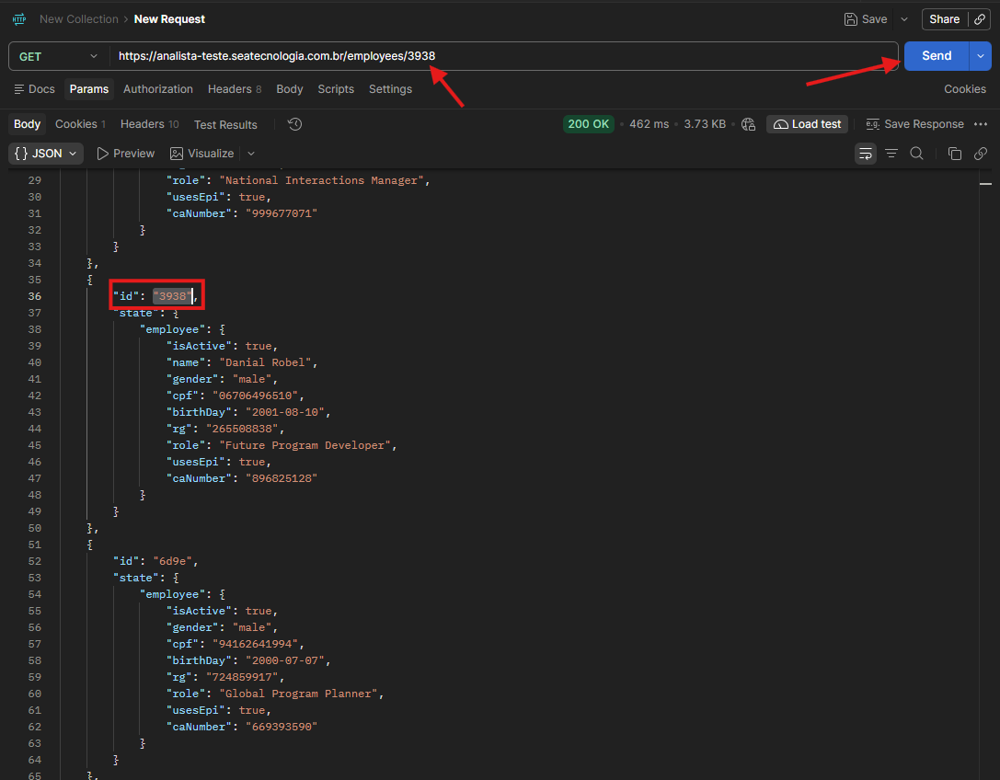
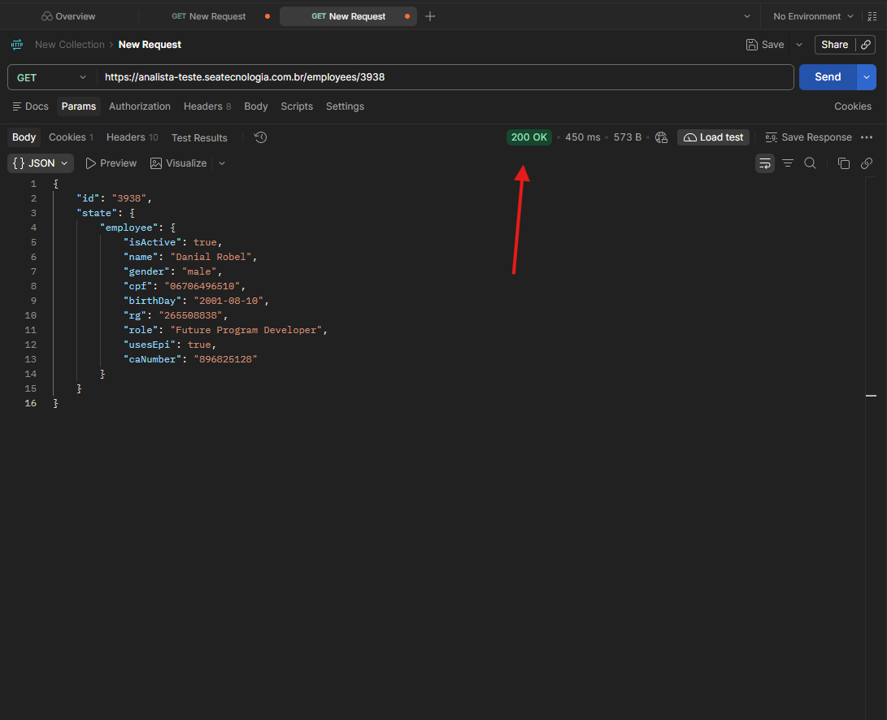
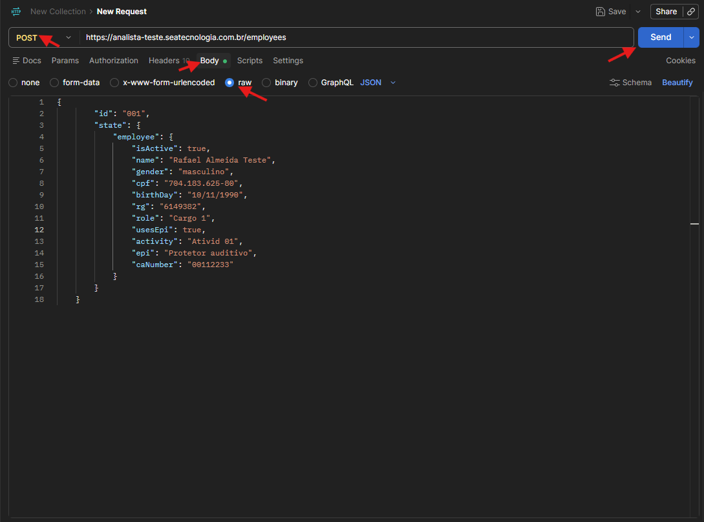
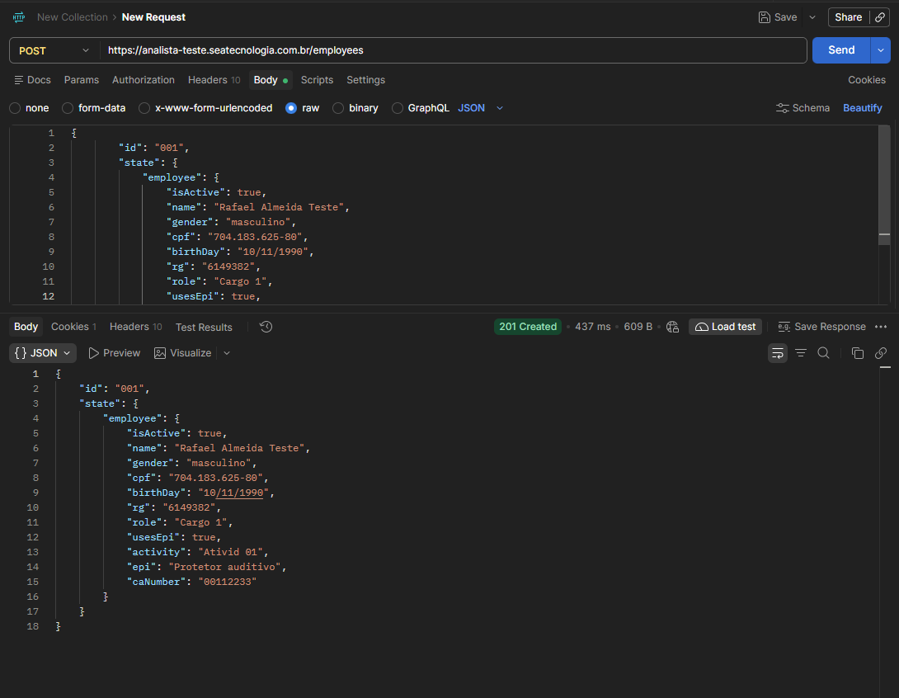
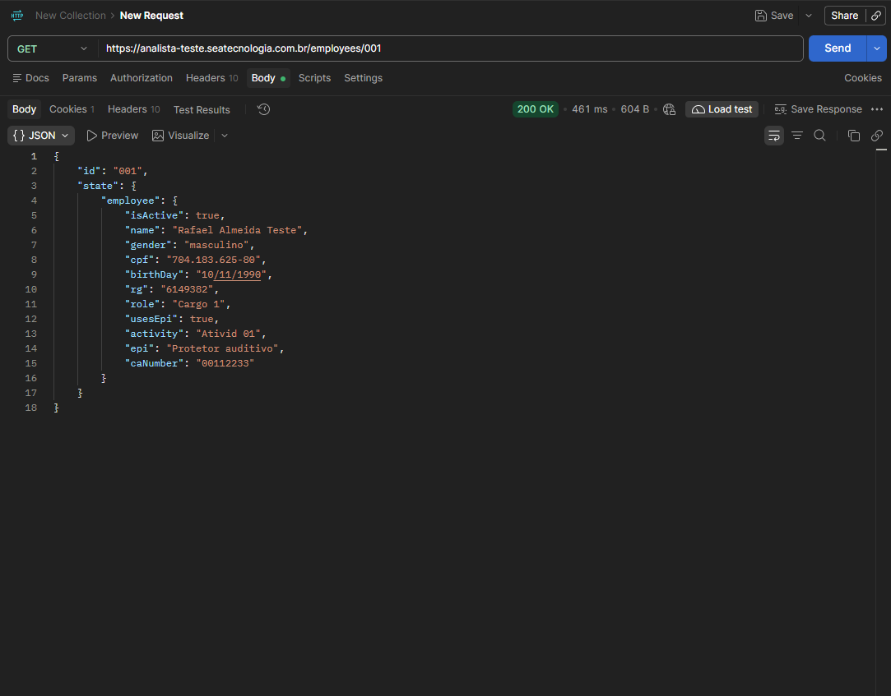
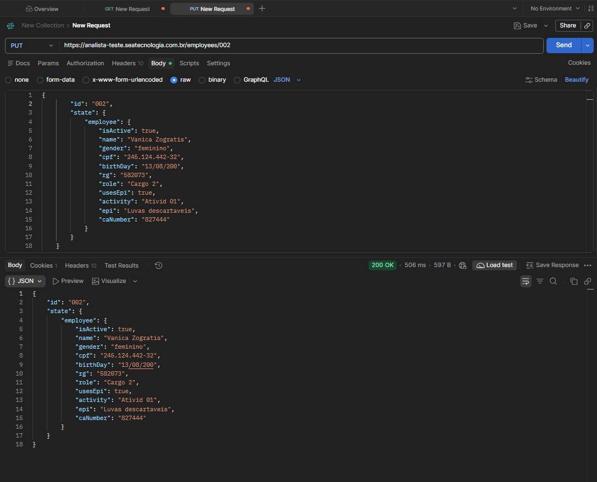
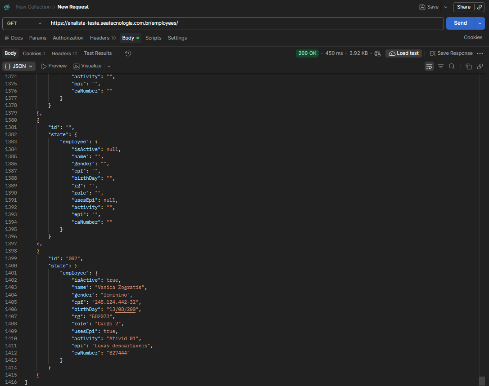
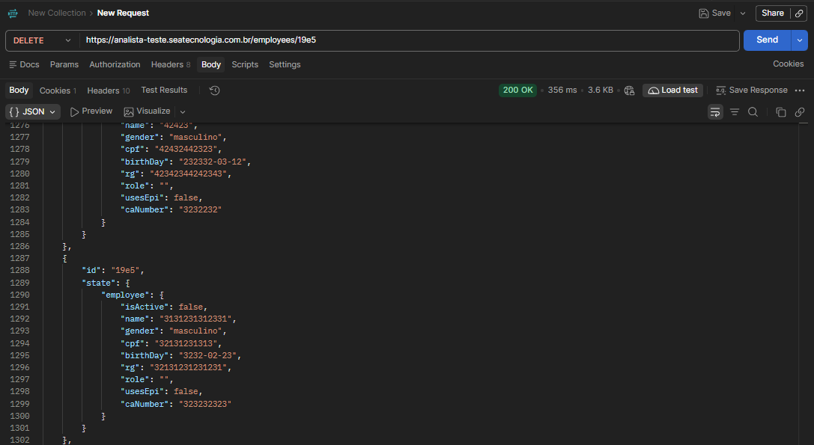
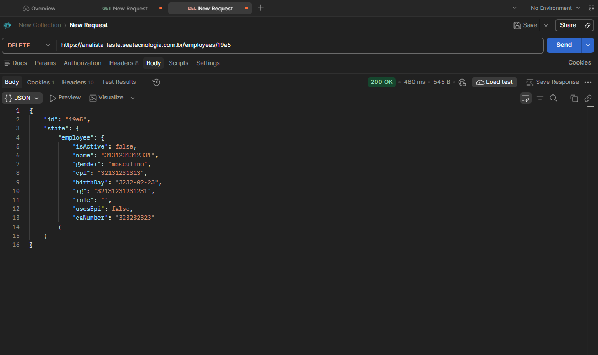
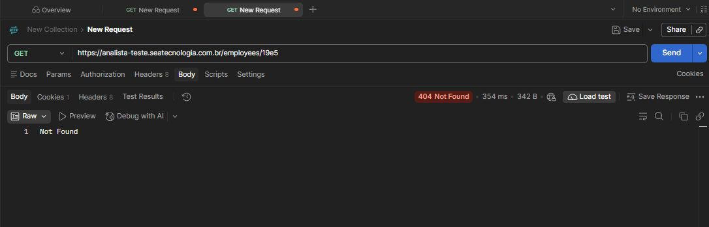

# Execução de Testes de API

# Evidência de Execução — EV-API-01

**ID:** CT-API-01
**Funcionalidade:** Consulta de funcionários
**Data da execução:**  29/10/2026 
**Endpoint:** https://analista-teste.seatecnologia.com.br/employees
**Método HTTP:** GET
**Ferramenta:** Postman
**Status:** Aprovado 

---

### 1. Pré-condições
- API REST disponível e acessível
- Endpoint de consulta identificado
- Método GET suportado
- Funcionários previamente cadastrados

### 2. Passos de execução
1. Acessar o Postman
2. Selecionar o método HTTP
3. Informar o endpoint
4. Enviar a requisição
5. Verificar o status HTTP e a resposta retornada

### 3. Dados Utilizados
**Endpoint:** "/employees" 
**Método:** GET  
**Body:** Não utilizado

### 5. Resultado esperado
- **Status HTTP:** 200 OK
- **Resposta esperada:** A API retorna a lista de funcionários cadastrados, contendo os dados previstos para consulta  

### 6. Resultado obtido
- **Status HTTP:** 200 OK
- **Resposta recebida:** A API retornou uma lista de funcionários em formato JSON, contendo informações cadastrais  
- **Comportamento observado:** A requisição foi processada com sucesso, e os registros retornados apresentaram dados dos campos: "isActive", "id", "name", "gender", "cpf", "rg", "birthday", "role", "activity", "epi", usesEpi,"caNumber"

**Evidência 16 — [Retorno da lista de funcionários cadastrados em formato JSON]**

### 7. Observações
Na evidência é visto que é retornado o "id": "1", ainda não se tem conhecimento se é ou não bug,
o resultado sairá após as execuções, também deve-se levar em consideração a regra de contrato da APIa cujo é desconhecido

---
# Evidência de Execução — EV-API-02

**ID:** CT-API-02
**Funcionalidade:** Consulta de funcionário
**Data da execução:**  29/10/2026 
**Endpoint:** https://analista-teste.seatecnologia.com.br/employees
**Método HTTP:** GET
**Ferramenta:** Postman
**Status:** Aprovado 

---

### 1. Pré-condições
- API REST disponível e acessível
- Endpoint de consulta identificado
- Método GET suportado
- Funcionários previamente cadastrados

### 2. Passos de execução
1. Acessar o Postman
2. Selecionar o método HTTP
3. Informar o endpoint
4. Enviar a requisição
5. Verificar o status HTTP e a resposta retornada

### 4. Dados Utilizados
**Endpoint:** "/employees" 
**Método:** GET  
**Body:** Não utilizado

### 5. Resultado esperado
- **Status HTTP:** 200 OK
- **Resposta esperada:** A API deve retornar o JSON do funcionário cadastrado exibindo seus dados 

### 6. Resultado obtido
- **Status HTTP:** 200 OK
- **Resposta recebida:** A API retornou uma lista de funcionários em formato JSON, contendo informações cadastrais  
- **Comportamento observado:** A requisição foi processada com sucesso, e os registros retornados apresentaram dados dos campos: "id", "isActive", "name", "gender", "cpf", "birthday", "rg", "role", "usesEpi", "caNumber"

**Evidência 17 — [Consulta do funcionário por id]**

**Evidência 18 — [Retorno da resposta e do funcionário desejado exibindo seus dados]**

---

# Evidência de Execução — EV-API-03

**ID:** CT-API-03
**Funcionalidade:** Cadastro de funcionários
**Data da execução:**  29/10/2026 
**Endpoint:** https://analista-teste.seatecnologia.com.br/employees
**Método HTTP:** GET
**Ferramenta:** Postman
**Status:** Aprovado 

### 1. Pré-condições
- API REST disponível e acessível
- Endpoint de consulta identificado
- Método POST/GET suportado
- Funcionários previamente cadastrados

### 2. Passos de execução
1. Acessar o Postman
2. Selecionar o método HTTP
3. Informar o endpoint
4. Preencher os parâmetros ou o body, se necessário
5. Enviar a requisição
6. Verificar o status HTTP e a resposta retornada
7. Enviar requisição GET utilizando o id criado para consultar cadastro na lista

### 3. Dados Utilizados

**Endpoint:** "/employees" 
**Método:** POST/GET  
**Body/JSON:** 
{
        "id": "001",
        "state": {
            "employee": {
                "isActive": true,
                "name": "Rafael Almeida Teste",
                "gender": "masculino",
                "cpf": "704.183.625-80",
                "birthDay": "10/11/1990",
                "rg": "6149382",
                "role": "Cargo 1",
                "usesEpi" true,
                "activity": "Ativid 01",
                "epi": "Protetor auditivo",
                "caNumber": "00112233"
            }
        }
    }

### 4. Resultado esperado
- **Status HTTP:** 201 Created
- **Resposta esperada:** A API deve criar novo funcionário, apresentando a resposta de sucesso 201 Created, o JSON exibindo os dados desejados
e deve ser apresentado na consulta 

### 5. Resultado obtido
- **Status HTTP:** 201 Created
- **Resposta recebida:** A API retornou a resposta ""201 Created em formato JSON, contendo informações cadastrais  
- **Comportamento observado:** A requisição foi processada com sucesso, e os registros retornados apresentaram dados cadastrados e foi apresentado na consulta de funcionários

**Evidência 19 — [Criando funcionário com dados válidos]**

**Evidência 20 — [Retorno da resposta e lista de funcionários cadastrados em formato JSON]**

**Evidência 21 — [Consulta do funcionário cadastrado]**

---

# Evidência de Execução — EV-API-04

**ID:** CT-API-04
**Funcionalidade:** Cadastro de funcionários
**Data da execução:**  29/10/2026 
**Endpoint:** https://analista-teste.seatecnologia.com.br/employees
**Método HTTP:** POST
**Ferramenta:** Postman
**Status:** Reprovado 

### 1. Pré-condições
- API REST disponível e acessível
- Endpoint de consulta identificado
- Método POST/GET suportado
- Funcionários previamente cadastrados

### 2. Passos de execução
1. Acessar o Postman
2. Selecionar o método HTTP
3. Informar o endpoint
4. Preencher body apenas com esqueleto JSON
5. Enviar a requisição
6. Verificar o status HTTP e a resposta retornada
7. Caso cadastre enviar requisição GET para verificar cadastro na lista

### 3. Dados Utilizados

**Endpoint:** "/employees" 
**Método:** POST/GET  
**Body/JSON:** 
{
        "id": "",
        "state": {
            "employee": {
                "isActive": null,
                "name": "",
                "gender": "",
                "cpf": "",
                "birthDay": "",
                "rg": "",
                "role": "",
                "usesEpi": null ,
                "activity": "",
                "epi": "",
                "caNumber": ""
            }
        }
    }

### 4. Resultado esperado
- **Status HTTP:** 400 Bad Request
- **Resposta esperada:** A API deve impedir a ação da requisição, retornando o Status HTTP "400" Bad Request e a mesagem de erro

### 5. Resultado obtido
- **Status HTTP:** 201 Created
- **Resposta recebida:** A API não valida os campos, assim criando o funcionário, exibindo a resposta "201 Created", retornando o JSON com os campos vazios e sendo apresentado na consulta
- **Comportamento observado:** A requisição não foi impedida, os registros apresentaram os campos vazios na consulta de funcionários

**Evidência 22 — [Criando funcionário com campos ausentes]**

**Evidência 23 — [Funcionário cadastrado]**

**Evidência 24 — [Consulta do funcionário cadastrado com campos vazios]**

---

# Evidência de Execução — EV-API-05

**ID:** CT-API-05
**Funcionalidade:** Cadastro de funcionários
**Data da execução:**  29/10/2026 
**Endpoint:** https://analista-teste.seatecnologia.com.br/employees
**Método HTTP:** GET
**Ferramenta:** Postman
**Status:** Reprovado   

### 1. Pré-condições
- API REST disponível e acessível
- Endpoint de consulta identificado
- Método POST/GET suportado
- Funcionário cadastrado com o determinado cpf: "704.183.625-80"

### 2. Passos de execução
1. Acessar o Postman
2. Selecionar o método HTTP
3. Informar o endpoint
4. Preencher o body 
5. Enviar a requisição POST
6. Verificar o status HTTP e a resposta retornada
7. Enviar requisição GET utilizando o id criado para consultar cadastro na lista

### 3. Dados Utilizados

**Endpoint:** "/employees" 
**Método:** POST/GET  
**Body/JSON:** 
{
        "id": "002",
        "state": {
            "employee": {
                "isActive": false,
                "name": "Gojo satoru honrado",
                "gender": "masculino",
                "cpf": "704.183.625-80",
                "birthDay": "1999-12-04",
                "rg": "6293612",
                "role": "Cargo 4",
                "usesEpi" true ,
                "activity": "Ativid 04",
                "epi": "Protetor auditivo",
                "caNumber": "996283"
            }
        }
    }

### 4. Resultado esperado
- **Status HTTP:** 409 Conflict
- **Resposta esperada:** A API deve rejeitar a requisição apresentando a resposta "409 Conflict" e a mensagem de erro 

### 5. Resultado obtido
- **Status HTTP:** 201 Created
- **Resposta recebida:** A API permitiu a requisição retornando o Status HTTP "201 Created", o JSON do funcionário criado e foi apresentado na consulta de funcionários
- **Comportamento observado:** A requisição foi aceita, apresentando funcionário com cpf existente na consulta

**Evidência 25 — [Criando funcionário com cpf já existente]**

**Evidência 26 — [Retorno da resposta e cadastro do funcionário em JSON]**

**Evidência 27 — [Consulta do funcionário cadastrado com cpf já existente]**

---

# Evidência de Execução — EV-API-06

**ID:** CT-API-06
**Funcionalidade:** Cadastro de funcionários
**Data da execução:**  29/10/2026 
**Endpoint:** https://analista-teste.seatecnologia.com.br/employees
**Método HTTP:** POST
**Ferramenta:** Postman
**Status:** Reprovado 

### 1. Pré-condições
- API REST disponível e acessível
- Endpoint de consulta identificado
- Método POST/GET suportado
- Funcionários previamente cadastrados

### 2. Passos de execução
1. Acessar o Postman
2. Selecionar o método HTTP
3. Informar o endpoint
4. Preencher body
5. Enviar a requisição POST
6. Verificar o status HTTP e a resposta retornada
7. Caso cadastre enviar requisição GET para consultar cadastro na lista 

### 3. Dados Utilizados

**Endpoint:** "/employees" 
**Método:** POST/GET  
**Body/JSON:** 
{
        "id": "123",
        "state": {
            "employee": {
                "isActive": "FDFFSFSFSD",
                "name": 123432,
                "gender": 432432,
                "cpf": 13324,
                "birthDay": "iaflafalkf",
                "rg": "312312321adasdasdad",
                "role": 80802,
                "usesEpi": 21444,
                "activity": 4679,
                "epi": 273394,
                "caNumber": "SOLAVANCO"
            }
        }
    }

### 4. Resultado esperado
- **Status HTTP:** 400 Bad Request ou 422 Unprocessable Content
- **Resposta esperada:** A API deve impedir a criação do funcionário retornando e resposta de erro e mensagem apontando onde o erro se encontra

### 5. Resultado obtido
- **Status HTTP:** 201 Created
- **Resposta recebida:**  resposta de sucesso retornando corpo JSON da Requisição
- **Comportamento observado:** A API realizou o cadastro, retornando o Status "201 Created", o corpo da requisição e foi exibido na listagem de funcionários

**Evidência 28 — [Criando funcionário utilizando dados inválidos]**

**Evidência 29 — [Funcionário criado com sucesso]**

**Evidência 30 — [Consulta de funcionário exibindo dados inválidos]**

---

# Evidência de Execução — EV-API-07

**ID:** CT-API-07
**Funcionalidade:** Cadastro de funcionários
**Data da execução:**  29/10/2026 
**Endpoint:** https://analista-teste.seatecnologia.com.br/employees
**Método HTTP:** PUT
**Ferramenta:** Postman
**Status:** Aprovado 

### 1. Pré-condições
- API REST disponível e acessível
- Endpoint de consulta identificado
- Método PUT/GET suportado
- Funcionários previamente cadastrados

### 2. Passos de execução
1. Acessar o Postman
2. Selecionar o método HTTP
3. Informar o endpoint: "/employees/002"
4. Preencher os parâmetros ou o body
5. Enviar a requisição PUT
6. Verificar o status HTTP e a resposta retornada
7. Caso cadastre enviar requisição GET para consultar cadastro na lista 

### 3. Dados Utilizados

**Endpoint:** "/employees" 
**Método:** PUT/GET  
**Body/JSON:** 
{
        "id": "002",
        "state": {
            "employee": {
                "isActive": true,
                "name": "Vanica Zogratis",
                "gender": "feminino",
                "cpf": "245.124.442-32",
                "birthDay": "13/08/200",
                "rg": "582073",
                "role": "Cargo 2",
                "usesEpi": true,
                "activity": "Ativid 01",
                "epi": "Luvas descartaveis",
                "caNumber": "827444"
            }
        }
    }

### 4. Resultado esperado
- **Status HTTP:** 200 OK 
- **Resposta esperada:** resposta de sucesso retornando corpo JSON da Requisição

### 5. Resultado obtido
- **Status HTTP:** 200 Created
- **Resposta recebida:**  resposta de sucesso retornando corpo JSON da Requisição
- **Comportamento observado:** A API atualizou o funcionário desejado, retornando o o status esperado, o corpo da requisição e foi listado na consulta de funcionários

**Evidência 31 — [Retorno de atualização exibindo mensagem, resposta de status e corpo JSON da requisição]**

**Evidência 32 — [Consulta do funcionário com dados atualizados]**

---

# Evidência de Execução — EV-API-08

**ID:** CT-API-08
**Funcionalidade:** Cadastro de funcionários
**Data da execução:**  29/10/2026 
**Endpoint:** https://analista-teste.seatecnologia.com.br/employees
**Método HTTP:** PATCH
**Ferramenta:** Postman
**Status:** Reprovado

### 1. Pré-condições
- API REST disponível e acessível
- Endpoint de consulta identificado
- Método PUT/GET suportado
- Funcionários previamente cadastrados

### 2. Passos de execução
1. Acessar o Postman
2. Selecionar o método HTTP
3. Informar o endpoint: "/employees/002"
4. Preencher os parâmetros ou o body
5. Enviar a requisição PATCH
6. Verificar o status HTTP e a resposta retornada
7. Caso cadastre enviar requisição GET para consultar cadastro na lista 

### 3. Dados Utilizados

**Endpoint:** "/employees" 
**Método:** PUT/GET  
**Body/JSON:** 
{
  "id": "002",  
  "state": {
    "employee": {
      "name": "Sea Teste Atualizado"
    }
  }
}

### 4. Resultado esperado
- **Status HTTP:** 200 OK 
- **Resposta esperada:** resposta de sucesso retornando corpo JSON da Requisição

### 5. Resultado obtido
- **Status HTTP:** 200 OK
- **Resposta recebida:**  resposta de sucesso retornando corpo JSON da Requisição
- **Comportamento observado:** A API retornou o Status esperado, a resposta e o corpo da requisição no entanto sua ação atual foi referente ao status "201" Created, substituindo o cadastro do funcionário pelo JSON utilizado na requisição

**Evidência 33 — [Criando funcionário utilizando dados inválidos]**

**Evidência 34 — [Funcionário criado com sucesso]**

---

# Evidência de Execução — EV-API-09

**ID:** CT-API-09
**Funcionalidade:** Cadastro de funcionários
**Data da execução:**  29/10/2026 
**Endpoint:** https://analista-teste.seatecnologia.com.br/employees
**Método HTTP:** DELETE
**Ferramenta:** Postman
**Status:** Aprovado

### 1. Pré-condições
- API REST disponível e acessível
- Endpoint de consulta identificado
- Método DELETE/GET suportado
- Funcionários previamente cadastrados

### 2. Passos de execução
1. Acessar o Postman
2. Selecionar o método HTTP
3. Informar o endpoint: "/employees/"id do funcionário a ser deletado""
5. Enviar a requisição DELETE
6. Verificar o status HTTP e a resposta retornada
7. Realizar consulta pelo id do usuário deletado

### 3. Dados Utilizados

**Endpoint:** "/employees/"ID do funcionário"" 
**Método:** PUT/GET  
**Body/JSON:** nenhum

### 4. Resultado esperado
- **Status HTTP:** 200 OK / 404 Not Found
- **Resposta esperada:** resposta de sucesso retornando corpo JSON da Requisição / Not found

### 5. Resultado obtido
- **Status HTTP:** 200 OK / 404 Not Found
- **Resposta recebida:**  resposta de sucesso retornando corpo JSON da Requisição / Not found
- **Comportamento observado:** A API deletou o funcionário retornando o Status esperado, a resposta e o corpo da requisição, na consulta apresentou a resposta e mensagem de erro esperadas

**Evidência 35 — [Criando funcionário utilizando dados inválidos]**

**Evidência 36 — [Funcionário criado com sucesso]**

**Evidência 37 — [Funcionário criado com sucesso]**

